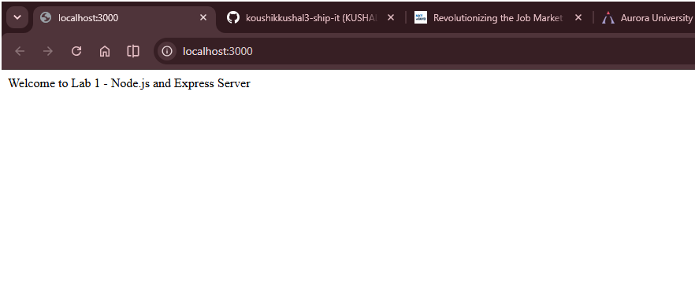
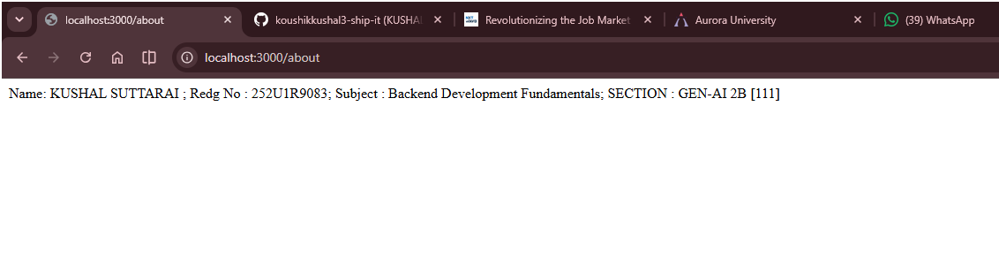
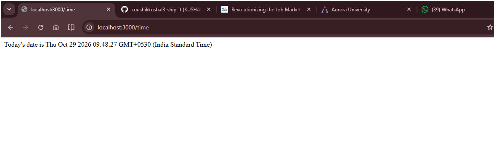
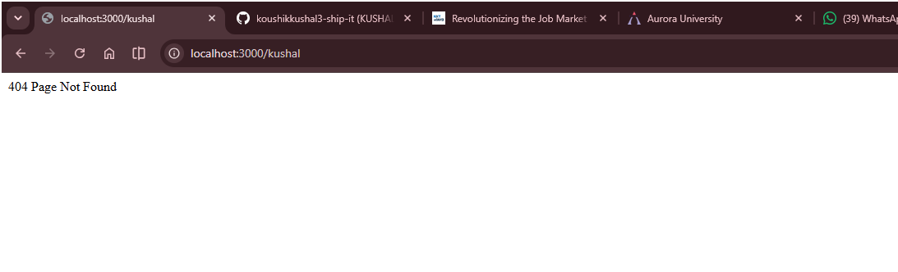

# Lab 1: Node.js and Express Server

**Name:** KUSHAL SUTTARAI
**Registration Number:** 252U1R9083
**Section:** GEN-AI 2B
**Room:** 111
**Course:** Backend Development Fundamentals
**Lab Number:** 01

**Live Link:** https://ladone.vercel.app/

## Objective

In this lab I made my first Node.js project. First I built a basic server with the `http` module, then I made an Express server with some routes and status codes.

## Technologies Used

- Node.js
- Express.js
- JavaScript
- npm
- Visual Studio Code

## Project Structure

```text
Lab-01/
├── Screenshots/
│   ├── Home.png
│   ├── about.png
│   ├── time.png
│   └── NotFound.png
├── http-server.js
├── index.js
├── package.json
├── package-lock.json
├── .gitignore
└── README.md
```

## How to Run

Make sure Node.js and npm are installed first.

1. Download or clone the project
2. Open the `Lab-01` folder in the terminal
3. Run `npm install`
4. Run `node index.js`
5. Go to `http://localhost:3000` in the browser

To run the basic http server use:

```bash
node http-server.js
```

Stop the first server with `Ctrl + C` before running the other one, since they use the same port.

## Endpoints

| Method | Endpoint | What it does | Status |
|--------|----------|--------------|--------|
| GET | `/` | Shows a welcome message | 200 OK |
| GET | `/about` | Shows my name and section in JSON | 200 OK |
| GET | `/time` | Shows current date and time | 200 OK |
| GET | `/anything` | Route that doesn't exist | 404 Not Found |

`/anything` is only an example. Any other route that isn't made will also show 404.

## Screenshots

**Home route** (welcome message)



**About route** (name and section)



**Time route** (date and time)



**Unknown route** (404 page)



## HTTP Status Codes

- **200 OK:** request worked fine
- **404 Not Found:** the route is not there

## Viva Questions

**1. Difference between `package.json` and `node_modules`?**
`package.json` keeps the project details, scripts and dependencies list. `node_modules` is the folder where all the installed packages are stored.

**2. What does `app.listen()` do?**
It starts the server and keeps it waiting for requests on the port we give.

**3. What are `request` and `response`?**
`request` has the info coming from the client. `response` is used to send data and status code back to the client.

## Problems I Faced

**1. 404 was not showing for wrong routes**
Unknown routes were not giving a proper 404. I fixed it by adding this at the very end, after all routes:

```js
app.use((req, res) => {
  res.status(404).send("404 - Page Not Found");
});
```

**2. Render deployment failed**
The build failed because my `package.json` was inside the `Lab-01` folder and not in the main folder. I changed the settings on Render:
- Root Directory: `Lab-01`
- Build Command: `npm install`
- Start Command: `node index.js`

After this it deployed properly.

## Git Notes

- `.gitignore` has `node_modules/`, `.env` and `desktop.ini` in it
- Don't push the `node_modules/` folder
- Screenshots are saved in the `Screenshots/` folder
- Submitted through the course GitHub repo


